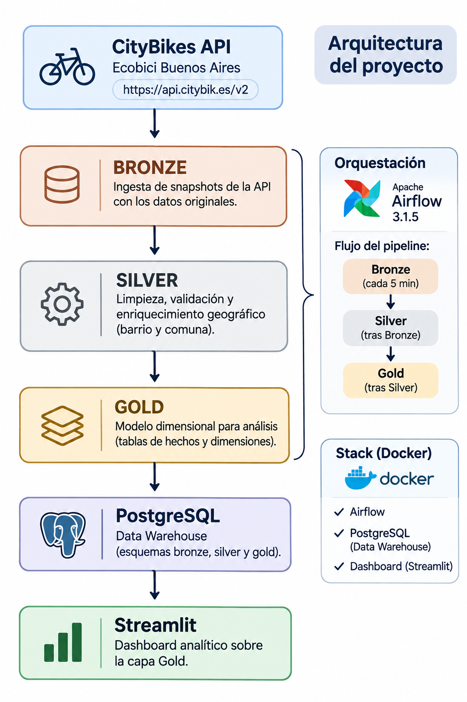
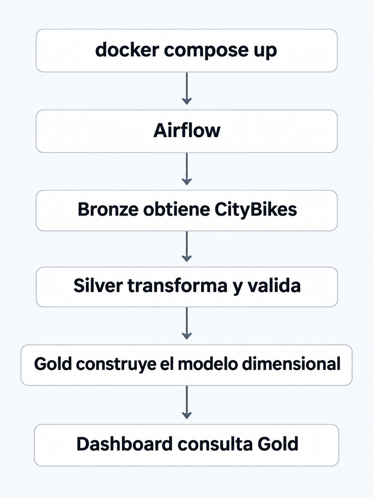

# TP Final — Infraestructura para Ciencia de Datos

**Universidad Nacional de San Martín (UNSAM)**  
**Licenciatura en Ciencia de Datos**  
**2.º Cuatrimestre 2026**

## Grupo 03 — CityBikes / Ecobici Buenos Aires

### Integrantes

| Nombre y apellido | Usuario de GitHub |
|---|---|
| Matías Agustín Alvarez | `MatiasAlvarez05` |
| Tomás Wolman | `Tomas-Wolman` |
| Karen Gonzales | `KarenGonzalesCh` |
| Ignacio Tomás Gauto | Pendiente |
| Luna Gomez | Pendiente |


---

# 1. Objetivo

El proyecto implementa un pipeline de datos **end-to-end** sobre una API pública utilizando una arquitectura Medallion:

**Bronze → Silver → Gold**

La fuente seleccionada es **CityBikes**, utilizando la red **Ecobici Buenos Aires**.

El objetivo es obtener snapshots periódicos de disponibilidad de las estaciones, enriquecerlos geográficamente, construir métricas horarias de ocupación y disponibilizar los resultados en un dashboard.

Todo el proyecto se encuentra containerizado y puede levantarse con Docker Compose.

---

# 2. Fuente de datos

**API:**  
https://api.citybik.es/v2

**Red utilizada:**  
Ecobici Buenos Aires

**Endpoint:**  
https://api.citybik.es/v2/networks/ecobici-buenos-aires

La API no requiere autenticación.

Cada consulta devuelve el estado actual de las estaciones, incluyendo información como:

- identificador y nombre de estación;
- latitud y longitud;
- bicicletas disponibles;
- espacios libres;
- capacidad;
- estado operativo;
- timestamp de la observación.

La ingesta Bronze se ejecuta automáticamente cada **5 minutos**.

---

# 3. Arquitectura

La solución implementa una arquitectura Medallion sobre PostgreSQL, orquestada mediante Apache Airflow.



La orquestación se realiza con **Apache Airflow 3.1.5**.

El flujo productivo es:

```text
citybikes_bronze
       |
       v
citybikes_silver
       |
       v
citybikes_gold
```

Solo Bronze posee un schedule periódico.

Bronze corre cada 5 minutos y, cuando termina correctamente, dispara Silver.  
Silver procesa los nuevos snapshots y, cuando termina correctamente, dispara Gold.

De esta forma se mantiene el orden:

**Bronze → Silver → Gold**

sin necesidad de ejecutar DAGs manualmente.

---

# 4. Capa Bronze

DAG:

```text
dags/01-bronze/dag_citybikes_bronze.py
```

Bronze consulta la API de CityBikes y persiste el snapshot recibido conservando la mayor cantidad posible de información del origen.

Entre los datos almacenados se encuentran:

- red;
- estación;
- coordenadas;
- bicicletas disponibles;
- espacios libres;
- capacidad;
- estado;
- timestamps;
- metadata de ingesta.

Además, cada ejecución conserva una copia del payload original en formato JSON dentro de:

```text
data/raw/
```

Los archivos generados durante las ejecuciones son datos de runtime y no se versionan en Git.

---

# 5. Capa Silver

DAG:

```text
dags/02-silver/dag_citybikes_silver.py
```

Silver procesa solamente snapshots que todavía no fueron tratados.

Las principales operaciones son:

- normalización de tipos;
- deduplicación por estación y snapshot;
- validación de identificadores;
- validación de coordenadas;
- validación de bicicletas y slots;
- cálculo de capacidad;
- cálculo del porcentaje de ocupación;
- clasificación del estado operativo;
- separación de registros válidos y registros en cuarentena;
- enriquecimiento geográfico.

## Enriquecimiento geográfico

Las coordenadas de cada estación se cruzan con un GeoJSON de barrios de la Ciudad Autónoma de Buenos Aires:

```text
data/reference/barrios_caba.geojson
```

Esto permite agregar:

- barrio;
- comuna;
- método de asignación geográfica;
- distancia al polígono cuando se utiliza el fallback de cercanía.

La capa Silver conserva también los registros inválidos en una tabla de cuarentena para mantener trazabilidad.

---

# 6. Capa Gold

DAG:

```text
dags/03-gold/dag_citybikes_gold.py
```

Gold construye un modelo dimensional orientado al consumo analítico y al dashboard.

## Modelo

```text
               dim_zona
                   |
                   |
              dim_estacion
                   |
                   |
       fact_ocupacion_por_hora
```

### `gold.dim_zona`

Contiene la dimensión geográfica:

- barrio;
- comuna;
- clave de zona.

### `gold.dim_estacion`

Contiene la información descriptiva de cada estación:

- identificador;
- nombre;
- dirección;
- coordenadas;
- capacidad;
- zona asociada.

### `gold.fact_ocupacion_por_hora`

Grano:

**una estación × una hora**

Incluye métricas como:

- cantidad de snapshots;
- capacidad promedio;
- bicicletas disponibles promedio;
- slots libres promedio;
- ocupación promedio;
- ocupación mínima y máxima;
- porcentaje de snapshots sin bicicletas;
- porcentaje de snapshots sin slots libres;
- porcentaje de snapshots completamente operativos.

Gold también ejecuta validaciones para detectar:

- dimensiones vacías;
- hechos vacíos;
- estaciones sin zona;
- duplicados;
- claves huérfanas.

---

# 7. Dashboard

El dashboard fue desarrollado en **Streamlit** y consume las tablas de la capa Gold.

**URL:**  
http://localhost:8501

Permite analizar:

- estaciones disponibles;
- bicicletas promedio;
- slots libres promedio;
- ocupación promedio;
- estaciones más saturadas para devolución;
- estaciones críticas para retiro;
- patrón de ocupación por hora;
- mapa de disponibilidad;
- filtros por comuna, barrio y estación.

## Interpretación

CityBikes entrega **snapshots de disponibilidad**, no eventos individuales de viaje.

Por este motivo, las métricas del dashboard representan:

**ocupación y disponibilidad observada a lo largo del tiempo**

y no una cantidad directa de viajes realizados.

---

# 8. Tecnologías utilizadas

- Docker
- Docker Compose
- Apache Airflow 3.1.5
- PostgreSQL 17
- Python 3.11
- Pandas
- SQLAlchemy
- Shapely
- Streamlit
- Plotly

---

# 9. Estructura del proyecto

```text
G03/
├── README.md
├── docker-compose.yml
├── Dockerfile
├── Dockerfile.postgres
├── init-airflow.sh
├── init.sql
├── requirements.txt
├── .env
│
├── dags/
│   ├── 01-bronze/
│   │   └── dag_citybikes_bronze.py
│   ├── 02-silver/
│   │   └── dag_citybikes_silver.py
│   └── 03-gold/
│       └── dag_citybikes_gold.py
│
├── data/
│   └── reference/
│       └── barrios_caba.geojson
│
├── docs/
│   └── images/
│       ├── arquitectura_citybikes.png
│       └── flujo_end_to_end.png
│
└── dashboard/
    ├── Dockerfile
    ├── app.py
    ├── db.py
    ├── requirements.txt
    └── pages/
        └── 1_Gold_Ocupacion.py
```

---

# 10. Cómo levantar el proyecto

Desde la raíz del repositorio:

```bash
cd TpFinal/grupos/G03
```

Construir y levantar todos los servicios:

```bash
docker compose up -d --build
```

Verificar que estén ejecutándose:

```bash
docker compose ps
```

Los servicios principales son:

```text
g03_airflow
g03_airflow_db
g03_data_warehouse
g03_dashboard
```

No es necesario:

- crear schemas manualmente;
- activar DAGs manualmente;
- ejecutar Bronze, Silver o Gold manualmente.

Al levantar el stack, Airflow comienza a ejecutar el pipeline automáticamente.

---

# 11. Enlaces importantes

## Airflow

http://localhost:8080

Credenciales:

```text
Usuario: admin
Contraseña: admin
```

Airflow utiliza `SimpleAuthManager` para este entorno académico/local.

Si un navegador conserva un token anterior y rechaza el login, eliminar los datos/cookies de `localhost:8080` o probar en una ventana de incógnito.

## Dashboard

http://localhost:8501

## CityBikes

https://api.citybik.es/v2/networks/ecobici-buenos-aires

---

# 12. Base de datos

El Data Warehouse utiliza PostgreSQL.

Los schemas son:

```text
bronze
silver
gold
```

Credenciales locales:

```text
Host: localhost
Puerto: 5432
Base: InfraCienciaDatos
Usuario: admin
Contraseña: admin
```

Estas credenciales son únicamente para el entorno académico/local.

---

# 13. Persistencia

Los datos de PostgreSQL se almacenan en volúmenes Docker.

Para detener el stack conservando los datos:

```bash
docker compose down
```

Para eliminar también los volúmenes:

```bash
docker compose down -v
```

> `docker compose down -v` elimina los datos persistidos de las bases.

---

# 14. Ejecución end-to-end

Al levantar el stack con Docker Compose, el pipeline comienza a ejecutarse automáticamente.



Bronze consulta periódicamente la API de CityBikes. Al finalizar correctamente, dispara Silver y, posteriormente, Gold. El dashboard consulta las tablas resultantes de la capa Gold.

El proyecto fue diseñado para que una instalación limpia pueda comenzar a generar datos automáticamente sin intervención manual.