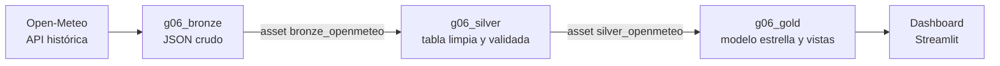
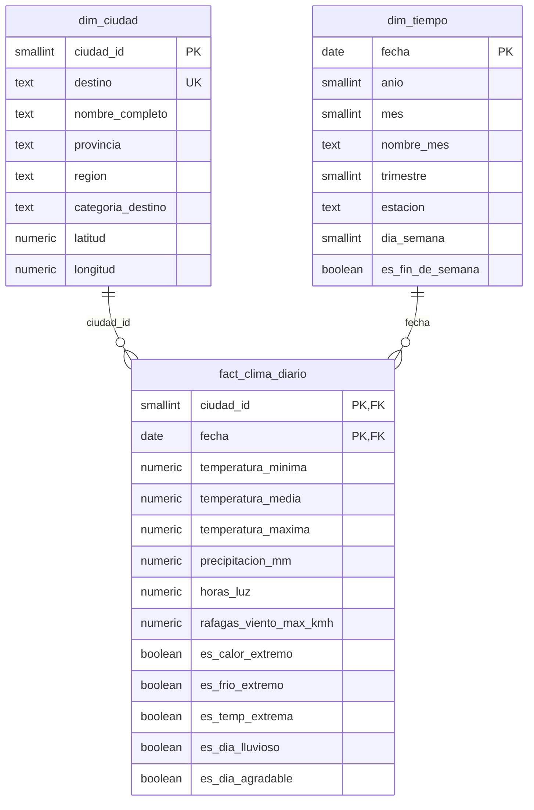

# TP Final - G06 - Open-Meteo

Pipeline de datos end-to-end con arquitectura **Medallion** (Bronze → Silver → Gold) sobre la API pública de **Open-Meteo**, orquestado con **Airflow 3.1.5**, almacenado en **PostgreSQL** y visualizado en un dashboard de **Streamlit**.

**Pregunta de negocio:** ¿en qué época del año conviene viajar a cada destino turístico de Argentina, según el clima?

---

## Integrantes

- Julian Tello ([@jtello94](https://github.com/jtello94))
- Agostina Bravo ([@agostbravo](https://github.com/agostbravo))
- Camila Dasso ([@camiladasso](https://github.com/camiladasso))
- Javier Valdez ([@JavierGValdez](https://github.com/JavierGValdez))
- Donato Scarinci ([@donascarinci](https://github.com/donascarinci))

## API elegida

| | |
|---|---|
| **Nombre** | Open-Meteo |
| **URL** | https://open-meteo.com/en/docs |
| **Endpoint usado** | API histórica (`archive-api.open-meteo.com/v1/archive`) |
| **Auth / API key** | Sin auth, no necesita API key |
| **Descripción** | Devuelve datos meteorológicos para las coordenadas que se consulten. Usamos la serie **diaria** histórica. |

## Decisiones de análisis

- **Destinos (3):**
  - Purmamarca, Jujuy (puna / quebrada)
  - San Carlos de Bariloche, Río Negro (montaña y lagos)
  - Puerto Iguazú, Misiones (selva)
- **Período:** del 12/11/2021 al 07/11/2026 (5 años). Son 1822 registros diarios por destino y 5466 en total.
- **Granularidad diaria:** permite comparar el mismo mes entre distintos años y calcular qué porcentaje de días fueron agradables, lluviosos o extremos.
- **Zona horaria:** consultamos con `timezone=auto`, así las fechas quedan en la hora local de cada destino.
- **Variables seleccionadas:**

| Variable de la API | Nombre en Silver | Descripción | Unidad |
|---|---|---|---|
| `temperature_2m_min` | `temperatura_minima` | Temperatura mínima diaria a 2 m | °C |
| `temperature_2m_mean` | `temperatura_media` | Temperatura media diaria a 2 m | °C |
| `temperature_2m_max` | `temperatura_maxima` | Temperatura máxima diaria a 2 m | °C |
| `precipitation_sum` | `precipitacion_mm` | Precipitación acumulada diaria | mm |
| `daylight_duration` | `duracion_luz_segundos` | Duración de la luz del día | segundos |
| `wind_gusts_10m_max` | `rafagas_viento_max_kmh` | Ráfagas máximas de viento a 10 m | km/h |

## Arquitectura



El stack arranca solo: **Bronze corre al levantar los contenedores y, cuando termina, dispara Silver y después Gold** mediante *Assets* de Airflow (`dags/common/assets.py`). Solo Bronze tiene un cron, porque es el borde que consulta la API.

### Bronze: datos crudos

Guarda en el schema `bronze` la respuesta de la API **tal cual**, en formato `JSONB`, con metadatos de auditoría: destino, `ingested_at` y `source`. No se transforma nada, así se puede reprocesar Silver sin volver a llamar a la API.

### Silver: datos limpios y validados

Convierte el JSON a una tabla `silver.clima_diario` con una fila por destino y día, según el contrato de datos (ver [`Contrato-silver-propuesta.md`](Contrato-silver-propuesta.md)):

- **Clave:** `destino` + `fecha`.
- **Tipos:** `fecha` DATE, el resto DECIMAL, `destino` VARCHAR.
- **Renombrado** de variables a nombres en español con unidad explícita.
- **Chequeos de calidad:** sin datos faltantes, sin duplicados de `destino` + `fecha`, y consistencia `mínima ≤ media ≤ máxima`.
- Es **idempotente**: se puede volver a correr sin duplicar filas.

### Gold: modelo estrella

**Grano:** una fila de `gold.fact_clima_diario` es **un destino en un día** (`ciudad_id` + `fecha`).

**Por qué Star y no Snowflake:** hay solo dos dimensiones chicas, sin jerarquías que justifiquen normalizar (provincia y región son columnas de `dim_ciudad`). Cada consulta del dashboard usa un único JOIN por dimensión.



**Banderas derivadas.** Los umbrales viven en la tabla `gold.umbrales` y se pueden ajustar sin tocar el código:

| Bandera | Criterio por defecto |
|---|---|
| `es_calor_extremo` | temperatura máxima ≥ 35 °C |
| `es_frio_extremo` | temperatura mínima ≤ -5 °C |
| `es_temp_extrema` | calor extremo **o** frío extremo (alimenta las alertas) |
| `es_dia_lluvioso` | precipitación ≥ 1 mm |
| `es_dia_agradable` | máxima entre 18 y 30 °C, mínima ≥ 5 °C, sin lluvia (< 1 mm) y ráfagas < 40 km/h |

**Vistas para el dashboard:**

- `gold.v_mejor_epoca`: por destino y mes, % de días agradables, % de días lluviosos, temperaturas, lluvia mensual promedio y ranking de meses. **Responde la pregunta principal.**
- `gold.v_alertas_temperatura`: un registro por cada día de temperatura extrema.
- `gold.v_lluvia_mensual`: historial de lluvia por destino, año y mes.

**Chequeos de calidad de Gold:** al final del DAG se verifica que no haya hechos sin dimensión, destinos de Silver sin `dim_ciudad` ni filas perdidas entre Silver y la tabla de hechos. Si alguno falla, el DAG queda en error.

## Dashboard

Streamlit, lee **solo de Gold**. Preguntas que responde:

1. ¿En qué mes conviene viajar a cada destino? (`v_mejor_epoca`)
2. Comparación del clima entre destinos para un mismo mes.
3. Alertas de temperatura extrema (`v_alertas_temperatura`).
4. Historial de lluvia (`v_lluvia_mensual`).

La portada muestra además el estado del pipeline.

## Cómo levantar el stack

Requisitos: Docker y Docker Compose.

```bash
cd TpFinal/grupos/G06/
docker compose up -d --build   # el .env ya viene en el repo
# Esperar ~30 s a que Airflow termine de inicializar
```

No hay que activar DAGs ni crear schemas a mano: Bronze arranca solo y dispara Silver y Gold.

**Accesos:**

| Servicio | URL | Usuario / contraseña |
|---|---|---|
| Airflow UI | http://localhost:8080 | `admin` / `admin` |
| Dashboard (Gold) | http://localhost:8501 | no requiere |
| Postgres (warehouse) | `localhost:5432` | ver `.env` (`admin` / `admin`, base `openmeteo`) |

> El `.env` se versiona a propósito (solo credenciales de juguete). Open-Meteo no necesita API key.

**Apagar:**

```bash
docker compose down            # apaga y conserva los datos
docker compose down -v         # apaga y BORRA los volúmenes (cuidado)
```
