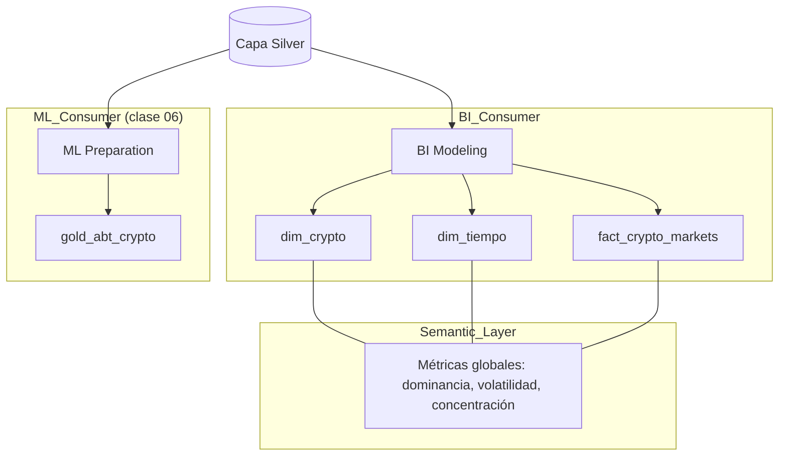
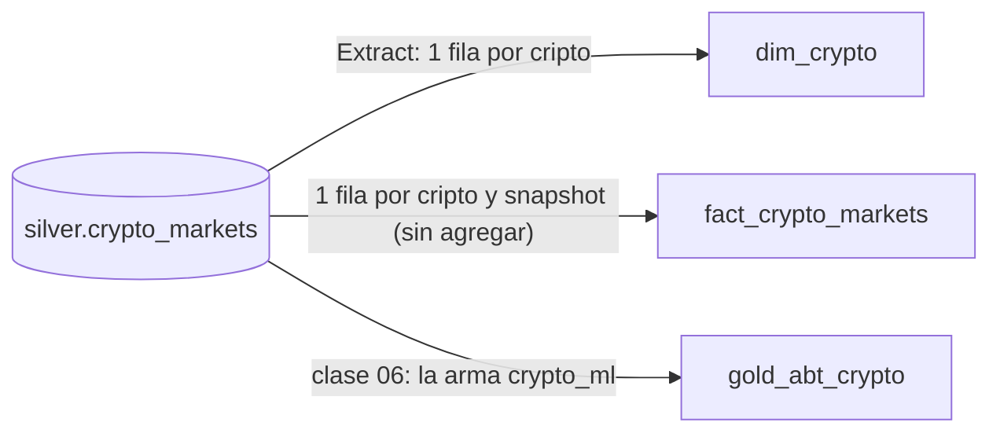

# Clase 05: La Bóveda (Capa Gold)

> 📚 **Cómo está estructurada esta clase** (patrón compartido por clase03/04/05/06):
>
> 1. **Notebook teórico** ([`clase05.ipynb`](clase05.ipynb)) — conceptos + DAG demo + consumo de Gold desde el notebook, sobre datos sintéticos (`silver.ventas_demo`) + **cinco queries medidas sobre el Gold real** del pipeline
> 2. **Ejercicio práctico (con entrega)** ([`ejercicios/ejercicio.ipynb`](ejercicios/ejercicio.ipynb)) — **un caso de negocio** —la cadena de gimnasios— donde el estudiante decide **qué es el hecho, cuáles las dimensiones y qué se mide**
> 3. **DAG productivo** ([`ejercicios/dag_crypto_gold.py`](ejercicios/dag_crypto_gold.py)) — para copy-paste a Airflow

> **Material de la clase**:
> - [`clase05.ipynb`](clase05.ipynb) — desarrollo teórico + el DAG pedagógico `gold_01_star_basico.py` (generado vía `%%writefile`), el chequeo de **integridad referencial en vivo**, el **consumo** del star desde el propio notebook y la sección **🔬 4.5 Cinco queries para ver si el modelo sirve**, la única de la teórica que mide sobre el warehouse productivo. La **ABT** pasó a la clase 06, que es donde se usa.
> - [`ejercicios/ejercicio.ipynb`](ejercicios/ejercicio.ipynb) — **el ejercicio entregable**, sin SQL y sin base de datos: un caso de negocio —una cadena de gimnasios, con las tablas que su sistema registra y las tres preguntas que el tablero tiene que contestar— y tres respuestas en castellano: **el hecho, las dimensiones y las métricas**. Es el mismo ejercicio que en la clase se desarrolla con el caso del hotel. La **📦 Entrega** genera el `.txt` en `ejercicios/estudiantes/` (ver [`ejercicios/README.md`](ejercicios/README.md)).
>
>   Las queries de SQL Gold que estaban acá se mudaron a **clase04** (E9 `GROUP BY` y E10 `HAVING`): son el primer paso de agregación y van mejor pegadas a los fundamentos de SQL.
> - [`ejercicios/dag_crypto_gold.py`](ejercicios/dag_crypto_gold.py) — DAG productivo, se copia al stack al final del ejercicio.

---

## 🔁 Continuidad con la clase 04

En la **clase 04** cargamos `silver.crypto_markets` con datos limpios validados contra el contrato `crypto_markets.yaml`, más una tabla `silver.quarantine_*` para los registros que fallaron Pydantic. En **Gold** consumimos `silver.crypto_markets` (NO `bronze.*`) y la transformamos en un modelo dimensional listo para BI (`dim_*` + `fact_*`). La **ABT** —la otra forma de Gold, para ML— la arma `crypto_ml` en la **clase 06**, que es el pipeline que la usa.

> **Decisión arquitectural** (excepción documentada): `fact_global_market` lee de `bronze.global_market` **directo**, salteándose Silver. Razón: el dato macro ya viene agregado por la API de CoinGecko (no son filas individuales que validar) y Silver no agrega valor. Está documentado en [`ejercicios/dag_crypto_gold.py`](ejercicios/dag_crypto_gold.py).

---

## 🎯 Objetivos

- Modelar datos para negocio usando el **Star Schema** (Hechos y Dimensiones).
- Entender las **claves sustitutas**: por qué el hecho no usa la clave del negocio.
- Comprender la importancia de la **Capa Semántica** y las métricas gobernadas.
- Asegurar la **integridad referencial** total en la capa final.

---

## 🏗️ Arquitectura de la Capa Gold



## 🗺️ Linaje de Datos (Gold)

En Gold, los datos se denormalizan para facilitar el consumo:



---

## 🚀 Setup

- Stack de la **Clase 02** corriendo (`docker compose up -d` desde `stack/`).
- Datos de Silver ya cargados (los generaste en la **Clase 04** corriendo el `dag_crypto_silver.py`).

**Sincronizá tu rama con el material nuevo.** Cada clase trae material nuevo en `main`. Antes de empezar a trabajar, traete los cambios:

```bash
# 1. Bajar lo nuevo de main
git checkout main
git pull origin main

# 2. Volver a tu rama personal y mergear
git checkout estudiante/apellido-nombre   # reemplazá por tu rama
git merge main --no-edit
```

> Vas a repetir esto al empezar **cada** clase. El detalle de cada comando está en el [README raíz](../README.md), sección "Cómo Consumir el Repo Semana a Semana".

---

## 📋 Cómo trabajar la clase

### Paso 1 — Leer el notebook teórico y correr los DAGs pedagógicos

Abrí `clase05.ipynb`. Arranca con qué es la capa Gold y para quién se modela, sigue con el Star Schema (grano, hecho y dimensiones) y cierra bajándolo a un DAG real sobre datos sintéticos:

| # | Archivo generado | Path destino | Qué introduce |
|---|---|---|---|
| 01 | `gold_01_star_basico.py` | `stack/dags/03-gold/` | Star Schema básico **en SQL (ELT)**: `dim_producto_demo` + `dim_tiempo_demo` + `fact_ventas_demo` con FKs vía `JOIN` (surrogate key con `ROW_NUMBER()`) |

> **¿Y las páginas Gold del dashboard (`3_Gold_Mercado.py`, `4_Gold_Velas.py`, `5_Gold_Analisis.py`)?** No se generan desde el notebook: **ya vienen en el stack**, en [`stack/dashboard/pages/`](../stack/dashboard/pages/), y se sirven con bind-mount. La sexta, `6_Gold_ML.py`, también viene en el stack, pero recién tiene datos que mostrar cuando la **clase 06** crea sus vistas.

Después de correr las celdas, los DAGs aparecen en Airflow UI (`localhost:8080`) — filtrá por tag **`gold`** para verlos juntos. La última sección del notebook lee esas tablas y las grafica ahí mismo.

> **Convenciones aplicadas** (consistente con ejercicios 03/04):
> - **Carpeta**: cada DAG vive en la capa Medallion destino (`03-gold/` para todo lo que escribe a `gold.*`).
> - **Tags**: sintéticos didácticos llevan `tags=["gold"]`. El productivo crypto lleva `tags=["prod", "gold", "crypto"]` — filtrá por `prod` en la UI para verlo separado de los didácticos.
> - **Numeración**: `gold_NN_xxx.py` con prefijo letra (igual que `bronze_NN_xxx.py` y `silver_NN_xxx.py`). Evita el bug histórico de Airflow con archivos que arrancan con dígito. Las páginas Streamlit del dashboard (`1_Bronze_Ingesta.py` … `6_Gold_ML.py`) SÍ arrancan con dígito porque es la **convención de orden de Streamlit** (no Airflow).

### Paso 2 — Hacer el ejercicio práctico (con entrega)

Abrí `ejercicios/ejercicio.ipynb`: no hace falta ni el stack ni DuckDB. Leé el caso de la cadena de gimnasios —qué registra el sistema y qué tres preguntas quiere contestar el tablero— y escribí tus tres respuestas: **el hecho**, **las dimensiones** y **las métricas**. No hay una única respuesta correcta; lo que se mira es que sean consistentes entre sí y que contesten las tres preguntas. Al final, la sección **📦 Entrega** genera `ejercicios/estudiantes/<apellido>-<nombre>.txt`, que se sube con commit + push: tu PR se actualiza solo. Reglas completas en [`ejercicios/README.md`](ejercicios/README.md).

**Commit y push.** Es **un** archivo. Desde la raíz del repo:

```bash
git add clase05/ejercicios/estudiantes/<apellido>-<nombre>.txt
git commit -m "clase05 (Gold)"
git push origin estudiante/apellido-nombre
```

> ⚠️ **No** uses `git add .` ni commitees el `.ipynb` modificado — es un template compartido entre todos los estudiantes.

> **Una rama para siempre, un PR para siempre**: tu rama `estudiante/apellido-nombre` y tu PR son los mismos desde la Clase 01; el push actualiza ese mismo PR (no abrís uno nuevo). Detalle en el [README raíz](../README.md).

### Paso 3 — Deploy del DAG productivo crypto

El DAG productivo de Gold (ahora **SQL ELT**, ver su header) se deploya copiándolo al stack — Airflow lo detecta solo:

```bash
# DAG productivo (escribe gold.* desde silver/bronze)
cp clase05/ejercicios/dag_crypto_gold.py stack/dags/03-gold/
```

El DAG **arranca solo** (`is_paused_upon_creation=False`): apenas Airflow lo detecta se suma a la **cadena data-aware**: se dispara cuando `crypto_silver` actualiza el asset `silver_crypto_markets`, sin cron propio. En la corrida siguiente vas a ver `gold.dim_crypto`, `gold.dim_tiempo`, `gold.fact_crypto_markets` y `gold.fact_global_market` poblándose con datos reales, más las **14 vistas semánticas** `gold.v_*` que crea la task `build_views` — la "API pública" de Gold que consumen el dashboard y el modelo. Van en tres grupos:
>
> - **Agregan a día**: `v_series_diaria`, `v_ohlc_diario`, `v_metricas_riesgo`, `v_amplitud_mercado`, `v_kpis_mercado`, `v_ohlc_mercado` (la vela del mercado entero, no la suma de las 50).
> - **Conservan el grano fino de snapshot**: `v_ultimo_snapshot`, `v_intradia`, `v_global_serie`, `v_concentracion`, `v_mercado_24h` (el 24 h calculado por nosotros al lado del que manda la API) y `v_mercado_contexto` (dónde cae el valor de hoy en la serie acumulada).
> - **Cortan por una dimensión**: `v_estacionalidad` (por `dim_tiempo`) y `v_por_categoria` (por `dim_crypto`). Son la misma pregunta con dos `GROUP BY` distintos, y existen para que el star schema se vea **funcionando** y no solo dibujado.
>
> Las del segundo grupo existen porque con pocos días de historia un análisis diario tiene 3 puntos y uno intradía tiene ~200: el pipeline ya recolecta cada 15 minutos, tirar esa resolución es gratis de evitar. Refrescá `localhost:8501` y las páginas Gold pasan de vacías a pobladas.

> El `docker-compose.yml` del stack tiene `./dashboard/pages:/app/pages` como bind-mount, así que el `cp` se ve en vivo sin rebuild de la imagen.
>
> ⚠️ **Ojo: el bind-mount es SOLO `pages/`.** `theme.py`, `db.py` y `app.py` van `COPY` dentro de la imagen (ver el `Dockerfile`). Si tocás uno de esos, editarlo y reiniciar el contenedor **no hace nada**: hay que `docker compose build dashboard`. Es un error fácil de cometer y difícil de ver, porque no falla — simplemente seguís mirando la versión vieja.

---

## 🎨 Dashboard incluido en el stack

El stack levanta un **dashboard de Streamlit** (`http://localhost:8501`) desde la **Clase 02**. Las páginas están **ordenadas por capa** — se leen de arriba hacia abajo como se lee el pipeline — y cada una responde **una** pregunta:

| # · Página | Pregunta que responde | Lee de |
|---|---|---|
| **1 · 🥉 Bronze — Ingesta** | ¿Llegó el dato? | `bronze.crypto_markets` |
| **2 · 🥈 Silver — Calidad** | ¿Sirve el dato? | `silver.crypto_markets` + `silver.quarantine_*` vs `bronze.*` |
| **3 · 🥇 Gold — Mercado** | ¿Qué dice el negocio? | `gold.v_kpis_mercado`, `gold.v_ultimo_snapshot`, `gold.v_mercado_24h`, `gold.v_mercado_contexto` |
| **4 · 🥇 Gold — Velas** | ¿Cómo se movió el mercado, y cada activo? | `gold.v_ohlc_mercado`, `gold.v_ohlc_diario` |
| **5 · 🥇 Gold — Análisis** | ¿Qué estructura hay detrás? | `gold.v_metricas_riesgo`, `gold.v_amplitud_mercado`, `gold.v_intradia`, `gold.v_concentracion`, `gold.v_estacionalidad`, `gold.v_por_categoria` |
| **6 · 🤖 Gold — ML** | ¿El modelo sirve? | `gold.v_ml_veredicto`, `gold.v_ml_aciertos`, `gold.v_volatilidad_diaria`, `gold.gold_abt_crypto` |

Dos cosas para notar, porque son **doctrina** y no detalle de implementación:

- **Los KPIs de las páginas 3–6 salen de vistas `gold.v_*`, no de tablas.** Esa es la **capa semántica** — la **API pública** de Gold: la métrica se define **una sola vez, en SQL**, y esa definición no se vuelve a escribir en cada página. Si mañana cambia la definición de "dominancia", cambia en un lugar.
  Las excepciones son deliberadas y de dos tipos. **Dimensiones y tablas que la página muestra como tema**: la 3 lee `gold.dim_crypto` para llenar el selector de categorías (es la dimensión, no una métrica), y la 6 lee `gold.gold_abt_crypto` y `gold.predicciones` porque su tema **es** la ABT y la tabla de predicciones. **Y el hecho, en dos lugares que la vista no puede dar**: la 3 lo consulta para la frescura del dato (`max(snapshot_ts)`) y la 6 para la volatilidad intradía, que necesita el grano de snapshot que la vista colapsó.
- **La demo de ventas NO es una página del dashboard, y es deliberado.** Esas tablas `gold.*_demo` son **sintéticas**: el dashboard muestra el pipeline **productivo** de criptomonedas, y mezclarle una demo de juguete confunde las dos cosas. El notebook de la clase la grafica ahí mismo — el patrón de consumo es idéntico, lo que cambia es dónde vive.

### ¿Querés agregar tu propia visualización?

Streamlit detecta cualquier `.py` que pongas en `stack/dashboard/pages/` (el prefijo define el orden, y el curso ya ocupa `1_` a `6_`), así que una página tuya aparece sola, sin rebuild. No es parte de la entrega: es para el que quiera seguir jugando. El modelo a copiar es `3_Gold_Mercado.py`, y con `st.metric`, `st.selectbox` y un gráfico ya tenés una página que se defiende.

---

## ✅ Verificación end-to-end

Después de correr `gold_01_star_basico` (sintético) + `dag_crypto_gold` (productivo), deberías poder responder estas 2 queries:

```sql
-- 1. ¿Las 4 tablas que escribe crypto_gold tienen datos?
SELECT 'dim_crypto'           AS tabla, COUNT(*) AS filas FROM gold.dim_crypto
UNION ALL
SELECT 'dim_tiempo',           COUNT(*) FROM gold.dim_tiempo
UNION ALL
SELECT 'fact_crypto_markets',  COUNT(*) FROM gold.fact_crypto_markets
UNION ALL
SELECT 'fact_global_market',   COUNT(*) FROM gold.fact_global_market
;
-- Esperado: las 4 con filas > 0

-- 2. Integridad referencial: ¿hay registros huérfanos en fact_crypto_markets?
SELECT COUNT(*) AS huerfanos
FROM gold.fact_crypto_markets f
LEFT JOIN gold.dim_crypto d ON f.crypto_id = d.crypto_id
WHERE d.crypto_id IS NULL;
-- Esperado: 0
```

Si las 2 queries devuelven valores razonables, tu pipeline Gold está **funcional + íntegro + listo para consumo BI**. (La ABT y su chequeo de features son de la clase 06, que es donde se construye.)

---

## 🔮 Forward reference a clase 06 (MLOps)

**Clase 06** es la **clase de cierre del cuatrimestre**: el pipeline pasa a modo producción y le metemos un modelo adentro. Tiene una **entrega chica y de criterio** — *El veredicto* — y no reemplaza al TP Final. Lo que vas a ver:

- **El pipeline, cerrado**: recap del cuatrimestre, las cuatro capas encadenadas por **Assets** (un solo cron, en Bronze), el switch a **modo producción** y los tres niveles de monitoring.
- **La ABT, hecha DAG**: la forma de tabla con la que se entrena un modelo. La arma `crypto_ml`, el pipeline que la usa — una tabla, un dueño.
- **Airflow para ML**: el modelo como una **task más**. Un DAG pedagógico que lee la ABT, entrena registrando en MLflow y escribe predicciones idempotentes; y el productivo `crypto_ml`, disparado **por el asset** `gold_star` (o sea cuando el modelo de Gold quedó armado y verificado), que arma la ABT y scorea.
- **MLflow como sistema**: tracking contra el server del stack, **Model Registry** y el alias `@champion` — promover es una decisión humana, y cambiar el alias cambia lo que predice el pipeline sin tocar código.
- **El tablero corrige al modelo**: la página `6_Gold_ML` mide el acierto contra lo que efectivamente pasó, y contra dos varas.
- **Bonus Track MLOps**: el mapa completo, con **cinco piezas ya hechas** en esa clase (tracking, registry, serving, training-serving skew y monitoring) y tres que quedan para después: Feature Stores, Drift Detection y Observability Gate.

> 🔁 **El círculo Medallion se cierra**: el contrato YAML que validó la **forma** del archivo en Bronze (clase 03) y la **semántica** de cada fila en Silver (clase 04) culmina en Gold con la **integridad referencial** del modelo dimensional (clase 05). En clase06 consumimos ese output para entrenar ML productivo + ver el cuadro completo. **Un solo contrato, cuatro capas, cuatro responsabilidades**.

---

## 🛠️ Troubleshooting

| Problema | Solución |
| :--- | :--- |
| El DAG no aparece en Airflow UI | Verificar que el archivo esté en `stack/dags/03-gold/`. Esperar 10-30s para que Airflow lo detecte. |
| El DAG corre pero las tablas Gold están vacías | Verificá que `crypto_silver` (clase 04) haya corrido antes y poblado `silver.crypto_markets`. |
| El DAG falla en `verify_integrity` con `Integridad Gold rota: N filas...` | Hay huérfanos: `crypto_id` en `fact_crypto_markets` que no están en `dim_crypto`. Las tablas Gold son `CREATE TABLE AS SELECT`, **sin foreign keys**, así que nada los impide: los caza ese chequeo, que corre antes de rehacer las vistas. Mirá si `dim_crypto` quedó a medio construir y volvé a correr el DAG completo. |
